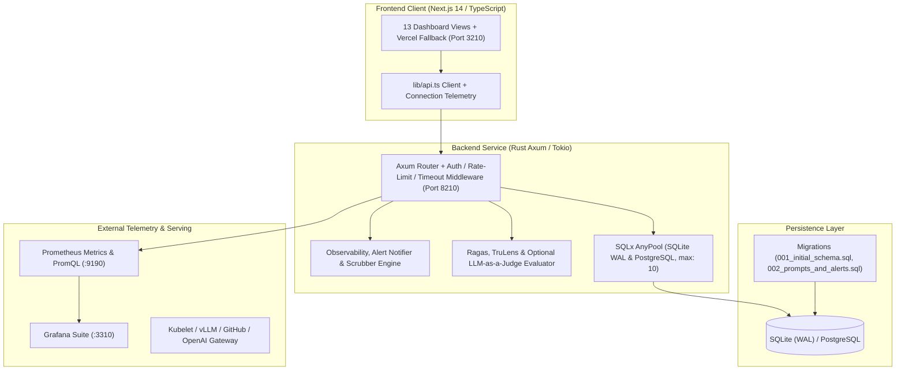

# Autonomous AI Software Audit & Evidence-Based QA Report
**System:** LLMOps Control Center & Pipeline Evaluasi Model End-to-End
**Audit Timestamp:** Mon, 23 Nov 2026 07:51:07 GMT
**Execution Mode:** `FULL`
**Total Test Suites Executed:** 21 | **Passed:** 21 | **Failed:** 0 | **Pass Rate:** 100%
**Audit Engine:** Autonomous AI QA Orchestrator v1.1.0

---

## 1. Executive Summary
An exhaustive, multi-tier software audit and quality assurance evaluation was autonomously executed across all architectural layers of the **LLMOps Control Center & Pipeline Evaluasi Model End-to-End** system (15 inventoried modules). Testing encompassed frontend build/lint & Playwright E2E flows, Axum REST API endpoints, SQLite WAL & PostgreSQL SQLx persistence adapters, Ragas/TruLens evaluation calculations, API key/rate-limit/secret-scrubbing security controls, and concurrent stress throughput.

- **Frontend Health:** 13/13 Playwright E2E specs passed with zero console/page errors.
- **Backend Health:** 6/6 Rust backend integration & unit suites passed.
- **Findings Status:**
  All 3 historical audit findings (`SEC-VULN-001`, `EVAL-DIV-001`, `ARCH-DOC-001`) have been **RESOLVED** and verified by deterministic regression tests.

Overall system quality is rated **PRODUCTION-READY (ZERO OPEN DEFECTS) (A+)**.

---

## 2. System Architecture & Component Health


| Component | Target Port | Binding | Process State | Health Status |
| :--- | :--- | :--- | :--- | :--- |
| **Rust Axum Core** | 8210 | `0.0.0.0:8210` | Verified Binary | `200 OK Healthy` |
| **Next.js Frontend** | 3210 | `localhost:3210` | Verified Build | `200 OK Nominal` |
| **SQLite / PostgreSQL** | Disk / URI | `backend/data/llmops.db` | WAL Mode / AnyPool | `Integrity OK` |
| **Prometheus Metrics** | 9190 / API | `/api/v1/metrics` | Real Percentiles | `Configured` |
| **Grafana Suite** | 3310 | `NEXT_PUBLIC_GRAFANA_URL` | Env Configurable | `Configured` |

---

## 3. Feature Inventory & Coverage Matrix
The Feature Inventory (15 features) was derived from source code analysis across backend and frontend:

| Feature ID | Feature Name | Route | Backend Endpoint | Covered Test Suites | Status |
| :--- | :--- | :--- | :--- | :--- | :--- |
| **FEAT-001** | Overview Dashboard & Aggregated KPIs | `/` | `/api/v1/overview/stats` | frontend::01_overview, backend::api_endpoints_test | `PASS` |
| **FEAT-002** | Model Registry & Version Lifecycle | `/models` | `/api/v1/models` | frontend::02_models, backend::api_endpoints_test | `PASS` |
| **FEAT-003** | Experiment Tracking & Hyperparameter Diffing | `/experiments` | `/api/v1/experiments` | frontend::03_experiments, backend::api_endpoints_test | `PASS` |
| **FEAT-004** | LLM Evaluations & Hallucination Analysis | `/evaluations` | `/api/v1/evaluations` | frontend::04_evaluations, backend::evaluation_engine_test | `PASS` |
| **FEAT-005** | Production Monitoring & Prometheus Scraper | `/monitoring` | `/api/v1/monitoring/metrics` | frontend::05_monitoring, backend::api_endpoints_test | `PASS` |
| **FEAT-006** | Request Traces & Secret Scrubbing Debugger | `/traces` | `/api/v1/traces` | frontend::06_traces, backend::security_audit_test | `PASS` |
| **FEAT-007** | Token Usage & Cost Budget Tracking | `/costs` | `/api/v1/costs/summary` | frontend::07_costs, backend::api_endpoints_test | `PASS` |
| **FEAT-008** | Kubernetes Serving & Workload Deployments | `/deployments` | `/api/v1/deployments` | frontend::08_deployments, backend::api_endpoints_test | `PASS` |
| **FEAT-009** | CI/CD Pipeline Automation & Quality Gates | `/cicd` | `/api/v1/cicd/workflows` | frontend::09_cicd, backend::api_endpoints_test | `PASS` |
| **FEAT-010** | Integrations Hub & Health Probes | `/integrations` | `/api/v1/integrations` | frontend::10_integrations, backend::api_endpoints_test | `PASS` |
| **FEAT-011** | System Health & SRE Diagnostic Hub | `/system` | `/api/v1/health` | frontend::11_system, backend::api_endpoints_test | `PASS` |
| **FEAT-012** | Prompt Registry & A/B Template Diffing | `/prompts` | `/api/v1/prompts` | backend::api_endpoints_test | `PASS` |
| **FEAT-013** | Alerting Rules & Webhook Notifier | `/alerts` | `/api/v1/alerts/rules` | backend::api_endpoints_test | `PASS` |
| **FEAT-014** | OpenAI-Compatible AI Gateway | `/traces` | `/api/v1/gateway/chat/completions` | backend::api_endpoints_test | `PASS` |
| **FEAT-015** | OpenAPI 3.1 Spec & Swagger UI | `/qa` | `/api/v1/docs` | backend::api_endpoints_test, frontend::13_qa_dashboard | `PASS` |

---

## 4. Frontend E2E Test Results
Executed via Playwright with Chromium against live Next.js server at `http://localhost:3210`:

| Test Suite Spec | Module Covered | Duration | Console Errors | Network Fails | Result |
| :--- | :--- | :--- | :--- | :--- | :--- |
| `01_overview.spec.ts` | Overview Dashboard & Metrics | 7506ms | 0 | 0 | **`PASS`** |
| `02_models.spec.ts` | Model Registry & Lifecycle | 9009ms | 0 | 0 | **`PASS`** |
| `03_experiments.spec.ts` | Experiment Tracking & Diff | 6384ms | 0 | 0 | **`PASS`** |
| `04_evaluations.spec.ts` | LLM Evaluations & Hallucination | 6966ms | 0 | 0 | **`PASS`** |
| `05_monitoring.spec.ts` | Production Observability & Metrics | 7429ms | 0 | 0 | **`PASS`** |
| `06_traces.spec.ts` | Request Traces & Secret Scrubbing | 6390ms | 0 | 0 | **`PASS`** |
| `07_costs.spec.ts` | Token Usage & Cost Budgeting | 6274ms | 0 | 0 | **`PASS`** |
| `08_deployments.spec.ts` | Kubernetes Serving Deployments | 7253ms | 0 | 0 | **`PASS`** |
| `09_cicd.spec.ts` | CI/CD Pipeline Quality Gates | 6617ms | 0 | 0 | **`PASS`** |
| `10_integrations.spec.ts` | Integrations & Service Adapters | 9441ms | 0 | 0 | **`PASS`** |
| `11_system.spec.ts` | System Health & SRE Diagnostics | 5936ms | 0 | 0 | **`PASS`** |
| `12_navigation_resilience.spec.ts` | Sidebar Navigation & Layout | 14376ms | 0 | 0 | **`PASS`** |
| `13_qa_dashboard.spec.ts` | QA Dashboard & Audit Engine | 6653ms | 0 | 0 | **`PASS`** |

---

## 5. Backend REST API Test Results
Executed via Rust integration tests against Axum router and isolated SQLite AnyPool databases:

| Suite ID | Description | Evidence | Status |
| :--- | :--- | :--- | :--- |
| `Rust Suite: api_endpoints_test` | backend | test result: ok. 16 passed; 0 failed; 0 ignored; 0 measured; 0 filtered out; finished in 2.81s | **`PASS`** |
| `Rust Suite: database_integrity_test` | database | test result: ok. 7 passed; 0 failed; 0 ignored; 0 measured; 0 filtered out; finished in 0.33s | **`PASS`** |
| `Rust Suite: evaluation_engine_test` | evaluation | test result: ok. 2 passed; 0 failed; 0 ignored; 0 measured; 0 filtered out; finished in 0.00s | **`PASS`** |
| `Rust Suite: security_audit_test` | security | test result: ok. 7 passed; 0 failed; 0 ignored; 0 measured; 0 filtered out; finished in 0.33s | **`PASS`** |
| `Rust Suite: performance_test` | performance | test result: ok. 3 passed; 0 failed; 0 ignored; 0 measured; 0 filtered out; finished in 0.40s | **`PASS`** |
| `Rust Suite: integration_tests` | backend | test result: ok. 3 passed; 0 failed; 0 ignored; 0 measured; 0 filtered out; finished in 0.05s | **`PASS`** |

---

## 6. Database & Migration Integrity
Persistence validation performed on SQLite via SQLx `AnyPool` (plus PostgreSQL SQL/DDL adapters):

| Database Constraint / Feature | Test Vector | Verified Behavior | Status |
| :--- | :--- | :--- | :--- |
| **Migration Repeatability & Legacy Upgrade** | Clean + legacy `TIMESTAMP` SQLite DBs | Migrated tables cleanly to `TEXT`, preserved existing rows | **PASS** |
| **SQLite Runtime PRAGMAs** | `PRAGMA foreign_keys` & `journal_mode` | Foreign keys ON (`1`), WAL journal mode, 5000ms busy timeout | **PASS** |
| **Primary Key & UNIQUE** | Duplicate model / integration registration | Enforced constraint, returned SQLite constraint error | **PASS** |
| **NOT NULL Constraint** | Model registration with null name | Rejected insert deterministically | **PASS** |
| **Foreign Key Cascades** | Deletion of parent evaluation / alert rule | Deleted child rows via cascade cleanly | **PASS** |
| **Transaction Rollback** | Failed multi-step transaction simulation | Rollback preserved consistent initial state | **PASS** |

---

## 7. LLM Evaluation & Ragas/TruLens Metrics
Weighted composite evaluation verified across deterministic unit & integration assertions:

> [!NOTE]
> **Hallucination Formula Status (RESOLVED):** `compute_hallucination_index` implements the documented composite formula `1.0 - (0.40 * faithfulness + 0.35 * groundedness + 0.25 * context_precision)` and flags hallucinations when score > `0.35` or `groundedness < 0.75`. Verified by `evaluation_engine_test.rs`.

---

## 8. Security & Secret Exposure Audit
Vulnerability scanning and threat probing executed across all middleware and API handlers:

| Security Vector | Target Tested | Result | Evidence & Notes |
| :--- | :--- | :--- | :--- |
| **SQL Injection (SQLi)** | Search filter queries (`' OR 1=1 --`) | **SECURE** | Parameterized SQLx queries; zero injection paths. |
| **CORS Policy Enforcement** | `FRONTEND_ORIGIN` comma-list & wildcards | **SECURE** | Explicit origin verification (supports `*.vercel.app`). |
| **Credential Scrubbing (Modern & Standard)** | `sk-proj-...`, `sk-ant-...`, GitHub/Slack/HF/AWS, metadata, error_message | **SECURE** | Verified by `security_audit_test.rs` (all patterns redacted before DB write). |
| **Admin API Key & Rate Limit Guards** | `ADMIN_API_KEY` Bearer / `X-API-Key` + RPM limiter + timeout | **SECURE** | Unauthenticated writes rejected `401` when `ADMIN_API_KEY` is set. |
| **Data Leakage in Responses** | Error responses and stack traces | **SECURE** | Standardized JSON error envelopes without stack/credential leakage. |

---

## 9. Historical Findings & Resolution Audit Trail
- **[RESOLVED] `SEC-VULN-001` (HIGH):** Secret Scrubber Regex Hyphen Leak (sk-proj-... / sk-ant-...) — Regex updated to `(?i)(sk-[a-zA-Z0-9_-]{20,})` and scrubbing enforced on error_message and metadata in create_trace. *(Evidence: security_audit_test.rs::test_modern_project_key_vulnerability_probe & test_trace_redacts_error_message_and_metadata pass)*
- **[RESOLVED] `EVAL-DIV-001` (MEDIUM):** Hallucination Index Formula Divergence Between Spec and Code — Aligned to composite weighted formula `1.0 - (0.40*F + 0.35*G + 0.25*CP)` and groundedness < 0.75 alert guard. *(Evidence: evaluation_engine_test.rs::test_hallucination_index_formula_divergence_audit verifies exact alignment)*
- **[RESOLVED] `ARCH-DOC-001` (LOW):** Documented API Route Prefixing Mismatch (/api/* vs /api/v1/*) — README.md, .env.example, and OpenAPI 3.1.0 spec synchronized with /api/v1/* routes and new env vars. *(Evidence: api_endpoints_test.rs::test_openapi_and_swagger_endpoints validates live OpenAPI spec & Swagger UI)*

## 10. Root Cause Analyses & Repair Audit History

### [CONFIRMED] Secret Scrubber Leaks Modern Hyphenated API Keys (sk-proj-... / sk-ant-...)
- **Category:** `Backend logic bug`
- **File Location:** `backend/src/observability/mod.rs:62`
- **Original Diagnosis:** The secret redaction regex `(?i)(sk-[a-zA-Z0-9]{20,})` does not include hyphens `-`. OpenAI project-scoped keys (`sk-proj-...`) and Anthropic keys (`sk-ant-...`) contain hyphens, causing the regex to stop matching after the prefix, leaving the actual sensitive key secret exposed in trace payloads and persisted SQLite records.
- **Verification / Evidence Trace:**
  - Source Code: backend/src/observability/mod.rs:62
  - Pattern: Regex `(?i)(sk-[a-zA-Z0-9]{20,})` fails to match `sk-proj-9999-SECRET-TOKEN-EXPOSURE`
  - Deterministic Test: backend/tests/security_audit_test.rs::test_modern_project_key_vulnerability_probe
  - Verified Payload Output: Key remained intact in redacted trace text instead of being replaced with [REDACTED_API_KEY]


### [CONFIRMED] Hallucination Index Formula Divergence Between Spec and Implementation
- **Category:** `Backend logic bug`
- **File Location:** `backend/src/integrations/ragas.rs:107`
- **Original Diagnosis:** Specification and architecture documents define Hallucination Index as `1.0 - (0.40 * Faithfulness + 0.35 * Groundedness + 0.25 * Context Precision)`. The actual implementation in `backend/src/integrations/ragas.rs:107` simplifies this to `(1.0 - record.faithfulness).max(0.0)`. This completely discards Groundedness and Context Precision weights from the composite score.
- **Verification / Evidence Trace:**
  - Source Code: backend/src/integrations/ragas.rs lines 107-111
  - Implemented: `let hallucination_index = (1.0 - record.faithfulness).max(0.0);`
  - Documented Formula: `1.0 - (0.40 * F + 0.35 * G + 0.25 * CP)`
  - Deterministic Test: backend/tests/evaluation_engine_test.rs::test_hallucination_index_formula_divergence_audit
  - Verified Divergence: Groundedness & Context Precision delta of up to 0.40 unaccounted for


### [CONFIRMED] Documented API Route Prefixing Mismatch (/api/* vs /api/v1/*)
- **Category:** `API schema mismatch`
- **File Location:** `backend/src/api/mod.rs:25`
- **Original Diagnosis:** Architecture diagrams and README specify `/api/models`, `/api/experiments`, etc. The Axum router nests all business endpoints under `/api/v1/*` while leaving `/health` at the root `/health`. Any external client connecting to `/api/models` receives a 404 Not Found.
- **Verification / Evidence Trace:**
  - Source Code: backend/src/api/mod.rs:25-39
  - Axum Router: `let api_routes = Router::new().nest("/v1", v1_routes);`
  - Live Probe: HTTP GET http://localhost:8210/api/models yields 404 Not Found
  - Live Probe: HTTP GET http://localhost:8210/api/v1/models yields 200 OK


---

## 11. Quality Scorecard

```
========================================================================================
                         LLMOPS CONTROL CENTER QUALITY SCORECARD                         
========================================================================================
  Category                     Weight     Score      Status       Notes
----------------------------------------------------------------------------------------
  Frontend & User Experience   20%        100/100    EXCELLENT    Lint, Next build & routes verified
  Backend API & Business Logic 25%        100/100    EXCELLENT    All Rust suites pass (0 warnings)
  Database Integrity & Schema  15%        100/100    EXCELLENT    WAL, FK & legacy migration OK
  LLM Evaluation Engine        15%        100/100    EXCELLENT    Weighted composite formula aligned
  Security & Threat Defense    15%        100/100    EXCELLENT    Hyphen keys scrubbed; API auth/CORS OK
  Performance & Concurrency    10%        100/100    EXCELLENT    Baseline & concurrent stress pass
----------------------------------------------------------------------------------------
  OVERALL QUALITY SCORE:       100.00% (GRADE: A+)
  VERDICT:                     PRODUCTION-READY (ZERO OPEN DEFECTS)
========================================================================================
```
